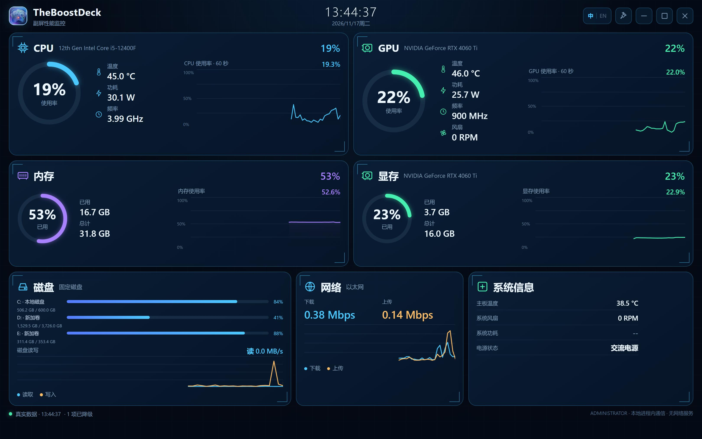
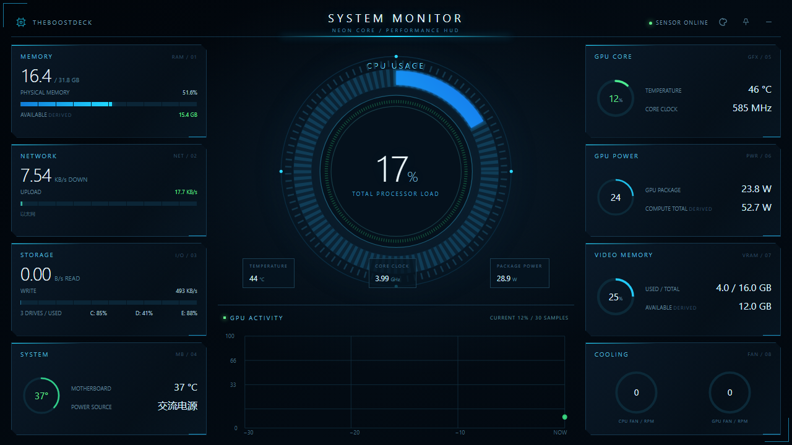
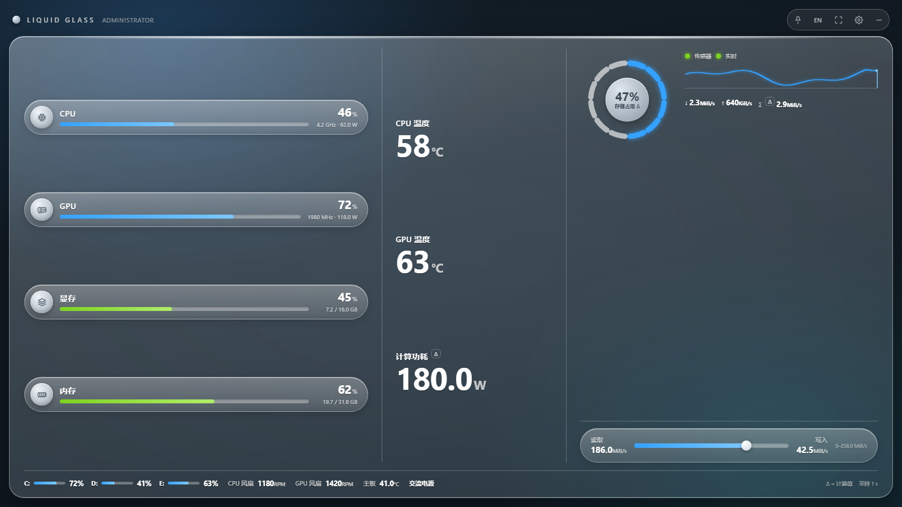
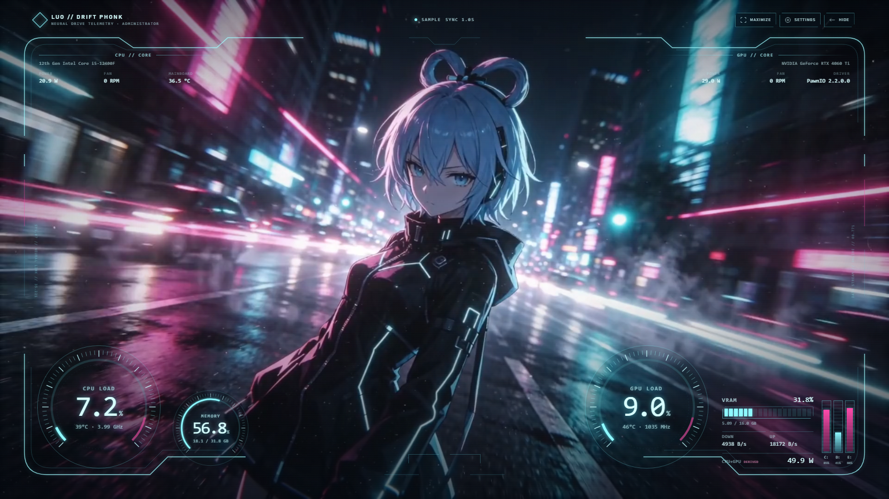
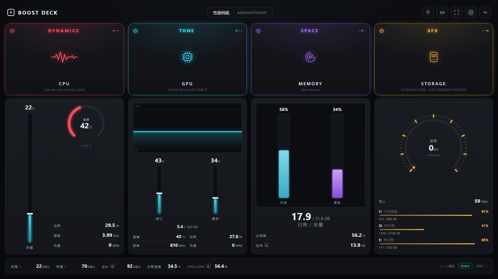

# TheBoostDeck

[简体中文](README.md) | **English**

TheBoostDeck is a Windows desktop performance monitor designed for a gamer's secondary display. It combines a WPF host, a WebView2 dashboard, and LibreHardwareMonitor sensors in a ready-to-use, responsive application. It can export a platform-aware SKILL for the current environment and let Agent tools quickly generate highly customized, high-impact skins.



## Highlights

- **Export a platform-aware SKILL and generate skins with an Agent.** Export a SKILL that contains this machine's sensor inventory, then use Agent tools to turn a reference image or text description into a complete, sensor-aware, high-impact `.boostskin` package.
- Real-time CPU, GPU, memory, dedicated VRAM, fixed-disk, network, and available motherboard sensors, including CPU fan RPM when exposed.
- Responsive 16:9 and 9:16 layouts with automatic card reflow during resize or orientation changes.
- Resizable always-on-top window, screen selection, tray hide/show, and persistent placement; window position, size, and UI zoom are remembered per skin and restored when that skin is activated again.
- Frameless HUD header with language, pin, hide-to-tray, maximize/restore, and close controls; maximize respects the current monitor work area and taskbar.
- Per-monitor DPI awareness and physical GPU/network filtering.
- Host-owned control center for language, refresh cadence, always-on-top, and optional start-with-Windows; the skin gallery lives alongside these settings.
- One shared sampling scheduler with a 0.1–5 s cadence selectable from the control center or tray; snapshots are batched into one process-local message per tick.
- Sampling and chart rendering pause when the window is hidden.

## Skins

The dashboard is fully skin-driven. A skin is a portable `.boostskin` package that can replace the whole UI. Use the host control center's Skins tab to preview and switch installed skins, import packages from other players, or export the current skin. Double-clicking a `.boostskin` file in Explorer imports and applies it the same way. The bundled authoring SKILL can produce a complete, platform-aware skin from a reference image or a text description.









## Requirements

- 64-bit Windows 10 version 1809 or later, or Windows 11.
- Microsoft Edge WebView2 Runtime. It is preinstalled on many Windows 10/11 systems.
- The officially signed PawnIO 2.2.0 installer ships with the release. When PawnIO is missing, the application runs it silently during startup; Windows still shows a UAC confirmation. Once installed, CPU temperature, per-core clock, and package power become available.
- The published application is self-contained and does not require a separate .NET Desktop Runtime installation.

## Run

1. On first launch, if PawnIO is missing, the application automatically runs the bundled official installer and performs a silent installation. Windows may show a UAC prompt; approve it. No manual download is required. The application continues starting after the installer finishes. If the driver is older than 2.2.0, UAC is cancelled, or installation fails, the dashboard explains the cause and the application continues with degraded metrics.
2. Start `TheBoostDeck.exe`.
3. The window opens on the Windows primary display by default. Use the tray menu to move it to another monitor.
4. Use the gear button to open the control center. Set the language, refresh cadence, always-on-top, and optionally start TheBoostDeck with Windows.
5. Use the pin button or tray menu to toggle always-on-top.
6. Use the tray menu to move the window to another screen.
7. Minimizing or closing the window through the Windows shell hides it to the tray and pauses sampling. Double-click the tray icon or choose **Show / Hide** to restore it.
8. Use the header close button or choose **Exit** in the tray menu to exit completely.

The first release is not code-signed, so Windows SmartScreen may show a warning.

## PawnIO driver

TheBoostDeck ships the officially signed PawnIO 2.2.0 installer alongside the application. At startup it reads PawnIO's uninstall registration. If the driver is missing, the application runs the bundled installer with `-install -silent` before initializing the hardware collector. The installer requires administrator rights, so Windows still shows a UAC prompt; TheBoostDeck never bypasses or disables UAC.

The application verifies the installer's SHA-256 before launching it and refuses to run a modified file. After a successful installation, the hardware collector re-detects the driver without requiring a manual restart. If UAC is cancelled, installation fails, or a restart is still required, the application starts normally with degraded CPU temperature, clock, and package power values, and the dashboard explains why. The next launch tries again.

The bundled 2.2.0 installer has a valid Authenticode signature and SHA-256 `1f519a22e47187f70a1379a48ca604981c4fcf694f4e65b734aaa74a9fba3032`. PawnIO is an independent GPL-2.0-or-later project with a device-driver linking exception; the installer is redistributed unmodified. See `THIRD-PARTY-NOTICES.md`, `licenses/PawnIO-NOTICE.txt`, and `licenses/PawnIO-GPL-2.0.txt` for licensing and source details.

## Custom theme

The first launch creates:

```text
%LocalAppData%\TheBoostDeck\themes\custom.css
```

Override CSS variables from `:root` in `src/TheBoostDeck.App/Web/dashboard.html`, then restart the application. The default file contains a commented example. No theme download or online theme store is used.

## Build from source

Install the .NET 8 SDK and WebView2 Runtime, then run from the repository root:

```powershell
dotnet restore .\TheBoostDeck.sln
dotnet build .\TheBoostDeck.sln --configuration Debug
dotnet test .\tests\TheBoostDeck.Tests\TheBoostDeck.Tests.csproj --configuration Debug
```

Publish a self-contained Windows x64 single-file build:

```powershell
dotnet publish .\src\TheBoostDeck.App\TheBoostDeck.App.csproj `
  --configuration Release `
  --runtime win-x64 `
  --self-contained true `
  -p:PublishSingleFile=true `
  -p:IncludeNativeLibrariesForSelfExtract=true `
  -p:EnableCompressionInSingleFile=true `
  -p:PublishTrimmed=false `
  --output .\artifacts\publish\TheBoostDeck
```

The publish directory automatically includes `PawnIO_setup.exe`, `THIRD-PARTY-NOTICES.md`, and the `licenses/PawnIO-*` license files. Distribute them together with `TheBoostDeck.exe`.

The dashboard HTML is embedded in the executable and extracted under `%LocalAppData%\TheBoostDeck\Web` at startup. Node.js is not required by the application; it is only used by the optional WebView2 capture script in `tools/`.

## Project layout

```text
src/TheBoostDeck.Core             Telemetry contracts, bounded buffer, sampling service
src/TheBoostDeck.Infrastructure   LibreHardwareMonitor and Windows data collection
src/TheBoostDeck.App              WPF host, WebView2 bridge, tray, settings, dashboard
tests/TheBoostDeck.Tests          Unit and serialization tests
tools/TheBoostDeck.HardwareProbe  Hardware diagnostics helper
tools/capture-webview.mjs         Optional responsive capture utility
docs/                             Design notes, screenshots, and verification records
```

## Verification and known limits

- All automated tests pass.
- Real WebView2 data and interactions were inspected through a loopback-only debugging session.
- Responsive captures cover 1280×720, 720×1280, and 1920×1080 with no horizontal overflow or JavaScript runtime errors.
- Topmost toggle, hide behavior, single-instance rejection, and persistent screen placement were exercised.
- Long-duration soak testing, game-frame-rate impact testing, sleep/resume, broad hardware compatibility, and a true standard-user versus administrator comparison remain release-validation work.
- FPS, frame time, game detection, in-game OSD, remote browser access, automatic updates, and hardware control are not included in this version.

## Privacy

TheBoostDeck does not upload telemetry. Settings, logs, extracted dashboard files, WebView2 data, and optional themes are stored locally under `%LocalAppData%\TheBoostDeck`.

## License

Project-owned code is licensed under Apache-2.0. See `LICENSE`, `THIRD-PARTY-NOTICES.md`, and `licenses/` for dependency terms.
