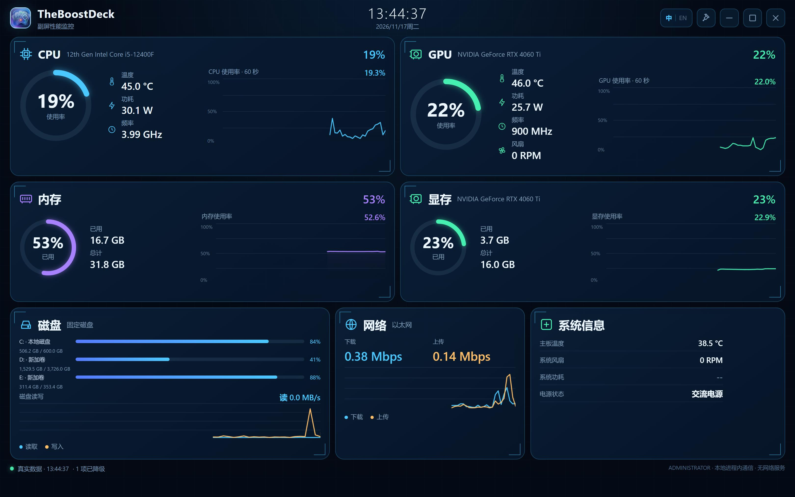
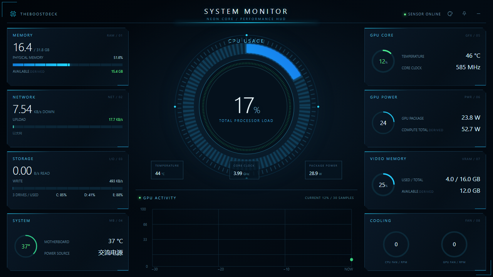
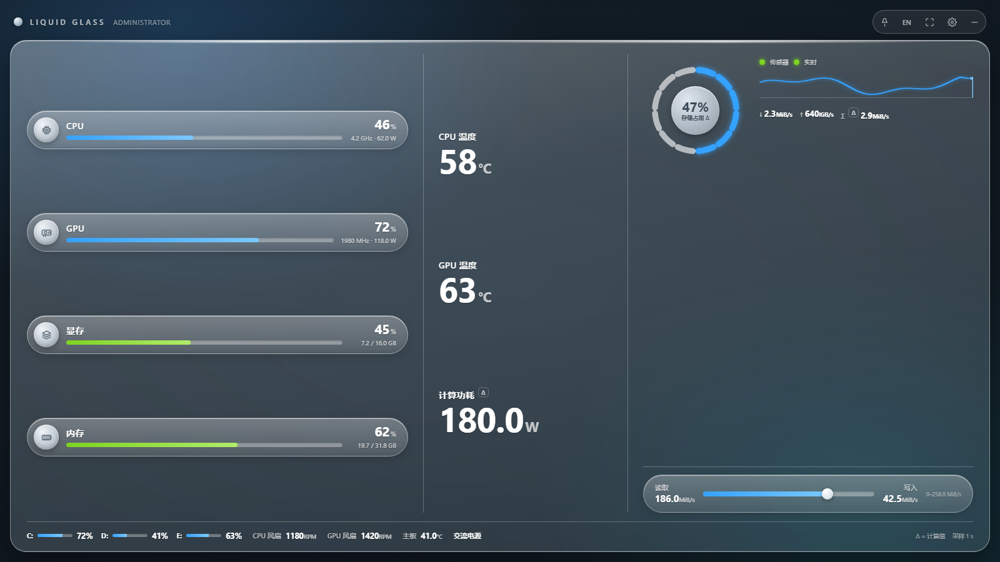
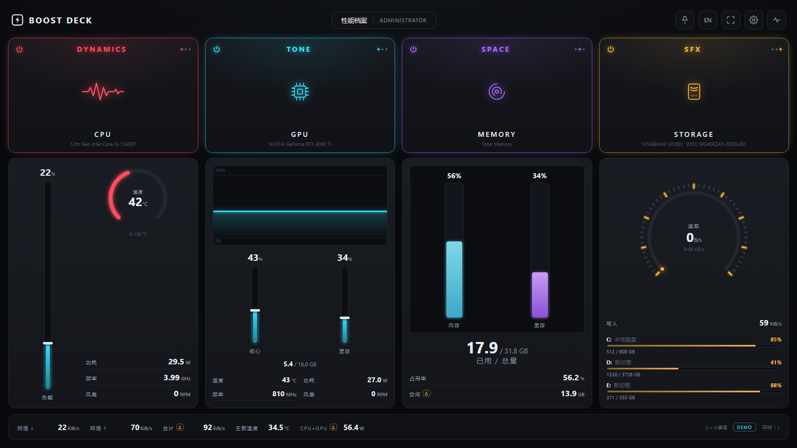

# TheBoostDeck

**简体中文** | [English](README.en.md)

TheBoostDeck 是面向游戏玩家副屏的 Windows 桌面性能监控工具。它将 WPF 宿主、WebView2 仪表盘与 LibreHardwareMonitor 传感器整合为一个开箱即用、可自适应的应用。支持导出当前环境 SKILL，并通过 Agent 工具快速生成高度自定义的酷炫皮肤。

*TheBoostDeck is a Windows desktop performance monitor designed for a gamer's secondary display. It combines a WPF host, a WebView2 dashboard, and LibreHardwareMonitor sensors in a ready-to-use, responsive application. It can export a platform-aware SKILL for the current environment and let Agent tools quickly generate highly customized, high-impact skins.*



## 功能亮点

- **面向当前环境导出 SKILL，Agent 直接生成皮肤。** 从控制中心导出包含本机传感器清单的皮肤制作 SKILL，内置参考图工作流与 16 套风格主题，再通过 Agent 工具把一张参考图或一句风格描述转换成完整、适配本机传感器的酷炫 `.boostskin` 皮肤包。
- 实时显示 CPU、GPU、内存、专用显存、固定磁盘、网络以及可用的主板传感器，包含可读取的 CPU 风扇转速。
- 支持 16:9 与 9:16 响应式布局，窗口缩放或屏幕方向变化时卡片自动重排。
- 可调整大小、始终置顶的窗口，支持屏幕选择、托盘隐藏/显示与位置持久化；窗口位置、大小与界面缩放按皮肤分别记忆，切回某个皮肤时恢复它上次的布局。
- 无边框 HUD 头部，包含语言、置顶、隐藏到托盘、最大化/还原和关闭按钮；最大化时遵循当前显示器工作区，不遮挡任务栏。
- 双击 `.boostskin` 文件即可导入并立即应用皮肤；文件类型在首次启动时以当前用户身份自动注册，无需管理员权限。
- 支持每显示器 DPI 感知，并按物理 GPU/网卡过滤。
- 宿主统一控制中心，集中管理语言、刷新频率、界面缩放、始终置顶与开机自启；皮肤库与这些设置并列。
- 共用一套采样调度器，控制中心或托盘菜单可选择 0.1–5 秒采样间隔，每个采样周期只发送一条批量化的进程内快照。
- 窗口隐藏时暂停采样和图表渲染。

### Highlights

- **Export a platform-aware SKILL and generate skins with an Agent.** Export a SKILL that contains this machine's sensor inventory, then use Agent tools to turn a reference image or text description into a complete, sensor-aware, high-impact `.boostskin` package.
- Real-time CPU, GPU, memory, dedicated VRAM, fixed-disk, network, and available motherboard sensors, including CPU fan RPM when exposed.
- Responsive 16:9 and 9:16 layouts with automatic card reflow during resize or orientation changes.
- Resizable always-on-top window, screen selection, tray hide/show, and persistent placement; window position, size, and UI zoom are remembered per skin and restored when that skin is activated again.
- Frameless HUD header with language, pin, hide-to-tray, maximize/restore, and close controls; maximize respects the current monitor work area and taskbar.
- Double-click a `.boostskin` file to import and apply it instantly; the file type registers per-user on first launch, no administrator rights required.
- Per-monitor DPI awareness and physical GPU/network filtering.
- Host-owned control center for language, refresh cadence, always-on-top, and optional start-with-Windows; the skin gallery lives alongside these settings.
- One shared sampling scheduler with a 0.1–5 s cadence selectable from the control center or tray; snapshots are batched into one process-local message per tick.
- Sampling and chart rendering pause when the window is hidden.

## 皮肤

仪表盘完全由皮肤驱动。皮肤是独立的 `.boostskin` 资源包，可以整体替换 UI。通过宿主控制中心的“皮肤”页预览、切换、导入他人分享的皮肤，也可以导出当前皮肤或删除不再需要的皮肤。在资源管理器中双击 `.boostskin` 文件，同样可以直接导入并应用。配套的皮肤制作 SKILL 可以直接把参考图或文字描述转换成适配本机传感器的完整皮肤包。








## 环境要求

- 64 位 Windows 10 版本 1809 或更高，或 Windows 11。
- Microsoft Edge WebView2 Runtime。许多 Windows 10/11 系统已预装。
- 官方签名的 PawnIO 2.2.0 安装器已随发布包附带。系统未安装 PawnIO 时，程序会在启动阶段自动执行静默安装；Windows 仍会弹出 UAC 确认。安装后即可读取 CPU 温度、每核心频率和封装功耗。
- 发布版应用是自包含的，不需要单独安装 .NET Desktop Runtime。

## 运行

1. 首次启动时，如果系统未安装 PawnIO，程序会自动运行随包附带的官方安装器并执行静默安装。Windows 可能弹出 UAC，请允许；无需自行下载。安装完成后程序会继续启动。若驱动版本低于 2.2.0、UAC 被取消或安装失败，仪表盘会提示相应原因，程序仍会以降级模式运行。
2. 启动 `TheBoostDeck.exe`。
3. 窗口默认在 Windows 主屏打开。使用托盘菜单可将其移动到其他显示器。
4. 使用齿轮按钮打开控制中心，可设置语言、刷新频率、始终置顶，以及按需开启开机自启。
5. 使用置顶按钮或托盘菜单切换始终置顶。
6. 使用托盘菜单把窗口移到另一块屏幕。
7. 通过 Windows 普通关闭或最小化窗口时，窗口会隐藏到托盘并暂停采样。双击托盘图标或选择 **显示 / 隐藏** 可恢复窗口。
8. 使用头部关闭按钮或托盘菜单中的 **退出** 完全退出程序。

首个发布版未进行代码签名，Windows SmartScreen 可能显示警告。

## PawnIO 驱动

TheBoostDeck 随发布包附带官方签名的 PawnIO 2.2.0 安装器。程序启动时会读取 PawnIO 的卸载注册信息；如果检测到驱动缺失，会在初始化硬件采集器之前自动运行随包安装器，并以 `-install -silent` 静默安装。安装器需要管理员权限，因此 Windows 仍会弹出 UAC 确认；TheBoostDeck 不会绕过或关闭 UAC。

程序在启动安装器前会校验安装包的 SHA-256，拒绝执行被篡改的文件。安装成功后无需手动重启，硬件采集器会立即重新检测驱动。若 UAC 被取消、安装失败或安装后仍需要重启，程序会照常启动，CPU 温度、频率和封装功耗显示为降级值，仪表盘会说明原因；下次启动会再次尝试安装。

随包的 2.2.0 安装包具有有效的 Authenticode 签名，SHA-256 为 `1f519a22e47187f70a1379a48ca604981c4fcf694f4e65b734aaa74a9fba3032`。PawnIO 是一个独立的 GPL-2.0-or-later 项目，带有设备驱动链接例外；安装器保持官方原样分发。许可证和源码获取方式详见 `THIRD-PARTY-NOTICES.md`、`licenses/PawnIO-NOTICE.txt` 和 `licenses/PawnIO-GPL-2.0.txt`。

## 自定义主题

首次启动会创建：

```text
%LocalAppData%\TheBoostDeck\themes\custom.css
```

在 `src/TheBoostDeck.App/Web/dashboard.html` 的 `:root` 中覆盖 CSS 变量，然后重启应用。默认文件包含一个带注释的示例。不会下载主题，也不提供在线主题商店。

## 从源码构建

安装 .NET 8 SDK 和 WebView2 Runtime，然后在仓库根目录运行：

```powershell
dotnet restore .\TheBoostDeck.sln
dotnet build .\TheBoostDeck.sln --configuration Debug
dotnet test .\tests\TheBoostDeck.Tests\TheBoostDeck.Tests.csproj --configuration Debug
```

发布自包含的 Windows x64 单文件构建：

```powershell
dotnet publish .\src\TheBoostDeck.App\TheBoostDeck.App.csproj `
  --configuration Release `
  --runtime win-x64 `
  --self-contained true `
  -p:PublishSingleFile=true `
  -p:IncludeNativeLibrariesForSelfExtract=true `
  -p:EnableCompressionInSingleFile=true `
  -p:PublishTrimmed=false `
  --output .\artifacts\publish\TheBoostDeck
```

发布目录会自动包含 `PawnIO_setup.exe`、`THIRD-PARTY-NOTICES.md` 以及 `licenses/PawnIO-*` 许可证文件；打包时请将它们与 `TheBoostDeck.exe` 一起分发。

仪表盘 HTML 嵌入在可执行文件中，启动时提取到 `%LocalAppData%\TheBoostDeck\Web` 下。应用本身不需要 Node.js；Node.js 仅用于 `tools/` 下的可选 WebView2 截图脚本。

## 项目结构

```text
src/TheBoostDeck.Core             遥测契约、定长缓冲区、采样服务
src/TheBoostDeck.Infrastructure   LibreHardwareMonitor 与 Windows 数据采集
src/TheBoostDeck.App              WPF 宿主、WebView2 桥接、托盘、设置、仪表盘
tests/TheBoostDeck.Tests          单元与序列化测试
tools/TheBoostDeck.HardwareProbe  硬件诊断辅助工具
tools/capture-webview.mjs         可选响应式截图工具
docs/                             设计说明、截图与验证记录
```

## 验证与已知限制

- 自动化测试全部通过。
- 通过仅监听回环地址的调试会话检查了真实 WebView2 数据与交互。
- 响应式截图覆盖 1280×720、720×1280 和 1920×1080，无横向溢出或 JavaScript 运行时错误。
- 已验证置顶切换、隐藏行为、单实例拒绝和屏幕位置持久化。
- 长时间稳定性测试、游戏帧率影响测试、睡眠/恢复、广泛的硬件兼容性，以及普通用户与管理员运行的完整对比，仍属于发布前验证工作。
- 本版本不包含 FPS、帧时间、游戏检测、游戏内 OSD、远程浏览器访问、自动更新和硬件控制。

## 隐私

TheBoostDeck 不上传遥测数据。设置、日志、提取的仪表盘文件、WebView2 数据以及可选主题都保存在本地 `%LocalAppData%\TheBoostDeck` 下。

## 许可证

项目自有代码采用 Apache-2.0 许可证。依赖条款详见 `LICENSE`、`THIRD-PARTY-NOTICES.md` 和 `licenses/`。
