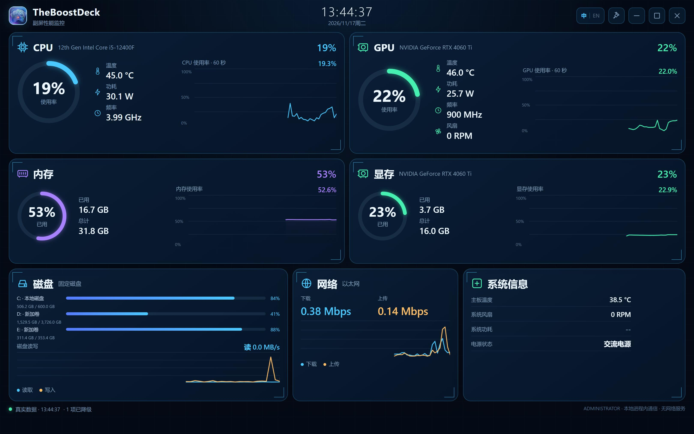
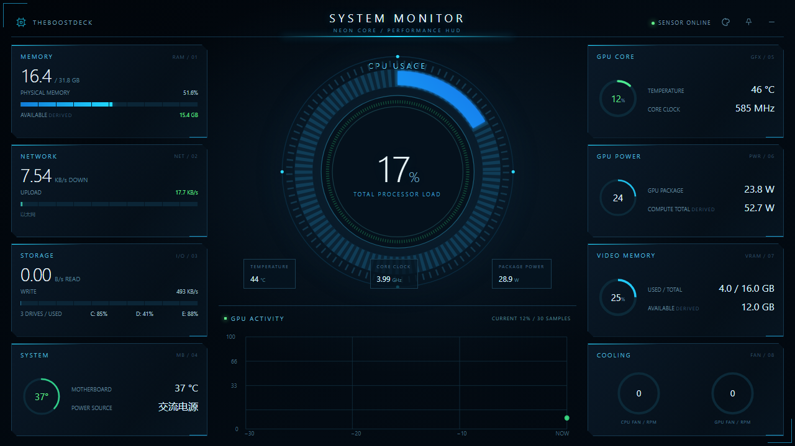

# TheBoostDeck

[English](README.md) | **简体中文**

> 本文为英文 README 的简体中文翻译；如有差异，以英文版为准。

TheBoostDeck 是面向游戏玩家副屏的 Windows 桌面性能监控工具。它将 WPF 宿主、WebView2 仪表盘与 LibreHardwareMonitor 传感器整合为一个开箱即用、可自适应的应用。



## 功能亮点

- **Skill 直接生成皮肤。** 配套的平台感知皮肤制作 Skill，可直接把参考图或文字描述转换成适配本机传感器的完整 `.boostskin` 皮肤包。
- 实时显示 CPU、GPU、内存、专用显存、固定磁盘、网络以及可用的主板传感器，包含可读取的 CPU 风扇转速。
- 支持 16:9 与 9:16 响应式布局，窗口缩放或屏幕方向变化时卡片自动重排。
- 可调整大小、始终置顶的窗口，支持屏幕选择、托盘隐藏/显示与位置持久化。
- 无边框 HUD 头部，包含语言、置顶、隐藏到托盘、最大化/还原和关闭按钮；最大化时遵循当前显示器工作区，不遮挡任务栏。
- 支持每显示器 DPI 感知，并按物理 GPU/网卡过滤。
- 共用一套采样调度器，托盘菜单可选择 0.1–5 秒采样间隔，每个采样周期只发送一条批量化的进程内快照。
- 窗口隐藏时暂停采样和图表渲染。

## 皮肤

仪表盘完全由皮肤驱动。皮肤是独立的 `.boostskin` 资源包，可以整体替换 UI。通过应用内皮肤管理器预览、切换、导入他人分享的皮肤，也可以导出当前皮肤。配套的皮肤制作 Skill 可以直接把参考图或文字描述转换成适配本机传感器的完整皮肤包。



## 环境要求

- 64 位 Windows 10 版本 1809 或更高，或 Windows 11。
- Microsoft Edge WebView2 Runtime。许多 Windows 10/11 系统已预装。
- [PawnIO](https://pawnio.eu/) 2.2.0 或更高版本，用于在 LibreHardwareMonitor 依赖 PawnIO 内核驱动的系统上读取 CPU 温度、每核心频率和封装功耗。没有它程序仍可启动，但这些 CPU 指标会降级为 `--`，仪表盘会提示缺少依赖。
- 发布版应用是自包含的，不需要单独安装 .NET Desktop Runtime。

## 运行

1. 如果 CPU 温度、频率或封装功耗对你很重要，请安装 PawnIO 2.2.0 或更高版本。可从 <https://github.com/namazso/PawnIO.Setup/releases/latest/download/PawnIO_setup.exe> 或 <https://pawnio.eu/> 下载，核对发布者并确认 UAC 提示。程序会检测驱动，并在驱动缺失或低于 2.2.0 时显示警告。
2. 启动 `TheBoostDeck.exe`。
3. 窗口默认在 Windows 主屏打开。使用托盘菜单可将其移动到其他显示器。
4. 使用置顶按钮或托盘菜单切换始终置顶。
5. 使用托盘菜单把窗口移到另一块屏幕。
6. 通过 Windows 普通关闭或最小化窗口时，窗口会隐藏到托盘并暂停采样。双击托盘图标或选择 **显示 / 隐藏** 可恢复窗口。
7. 使用头部关闭按钮或托盘菜单中的 **退出** 完全退出程序。

首个发布版未进行代码签名，Windows SmartScreen 可能显示警告。

## PawnIO 驱动

TheBoostDeck 不会静默安装内核驱动。程序启动时会读取 PawnIO 的卸载注册信息来检测驱动，并在驱动缺失、不可读或低于 2.2.0 时在仪表盘中给出警告。请使用官方签名安装程序自行安装；在同意 UAC 后，安装程序支持 `-install -silent`。

```powershell
.\PawnIO_setup.exe -install -silent
```

经测试的 2.2.0 安装包具有有效的 Authenticode 签名，SHA-256 为 `1f519a22e47187f70a1379a48ca604981c4fcf694f4e65b734aaa74a9fba3032`。PawnIO 是一个独立的 GPL-2.0-or-later 项目，带有设备驱动链接例外；它不属于 TheBoostDeck 的 Apache-2.0 源码，也不随本发布版分发。详见 `THIRD-PARTY-NOTICES.md`。

## 自定义主题

首次启动会创建：

```text
%LocalAppData%\TheBoostDeck\themes\custom.css
```

在 `src/TheBoostDeck.App/Web/dashboard.html` 的 `:root` 中覆盖 CSS 变量，然后重启应用。默认文件包含一个带注释的示例。不会下载主题，也不提供在线主题商店。

## 从源码构建

安装 .NET 8 SDK 和 WebView2 Runtime，然后在仓库根目录运行：

```powershell
dotnet restore .\TheBoostDeck.sln
dotnet build .\TheBoostDeck.sln --configuration Debug
dotnet test .\tests\TheBoostDeck.Tests\TheBoostDeck.Tests.csproj --configuration Debug
```

发布自包含的 Windows x64 单文件构建：

```powershell
dotnet publish .\src\TheBoostDeck.App\TheBoostDeck.App.csproj `
  --configuration Release `
  --runtime win-x64 `
  --self-contained true `
  -p:PublishSingleFile=true `
  -p:IncludeNativeLibrariesForSelfExtract=true `
  -p:EnableCompressionInSingleFile=true `
  -p:PublishTrimmed=false `
  --output .\artifacts\publish\TheBoostDeck
```

仪表盘 HTML 嵌入在可执行文件中，启动时提取到 `%LocalAppData%\TheBoostDeck\Web` 下。应用本身不需要 Node.js；Node.js 仅用于 `tools/` 下的可选 WebView2 截图脚本。

## 项目结构

```text
src/TheBoostDeck.Core             遥测契约、定长缓冲区、采样服务
src/TheBoostDeck.Infrastructure   LibreHardwareMonitor 与 Windows 数据采集
src/TheBoostDeck.App              WPF 宿主、WebView2 桥接、托盘、设置、仪表盘
tests/TheBoostDeck.Tests          单元与序列化测试
tools/TheBoostDeck.HardwareProbe  硬件诊断辅助工具
tools/capture-webview.mjs         可选响应式截图工具
docs/                             设计说明、截图与验证记录
```

## 验证与已知限制

- 自动化测试全部通过。
- 通过仅监听回环地址的调试会话检查了真实 WebView2 数据与交互。
- 响应式截图覆盖 1280×720、720×1280 和 1920×1080，无横向溢出或 JavaScript 运行时错误。
- 已验证置顶切换、隐藏行为、单实例拒绝和屏幕位置持久化。
- 长时间稳定性测试、游戏帧率影响测试、睡眠/恢复、广泛的硬件兼容性，以及普通用户与管理员运行的完整对比，仍属于发布前验证工作。
- 本版本不包含 FPS、帧时间、游戏检测、游戏内 OSD、远程浏览器访问、自动启动、自动更新和硬件控制。

## 隐私

TheBoostDeck 不上传遥测数据。设置、日志、提取的仪表盘文件、WebView2 数据以及可选主题都保存在本地 `%LocalAppData%\TheBoostDeck` 下。

## 许可证

项目自有代码采用 Apache-2.0 许可证。依赖条款详见 `LICENSE`、`THIRD-PARTY-NOTICES.md` 和 `licenses/`。
